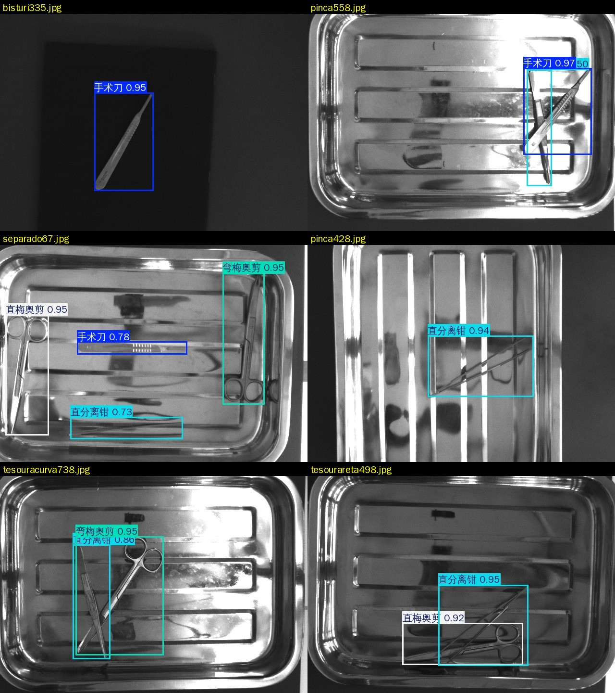
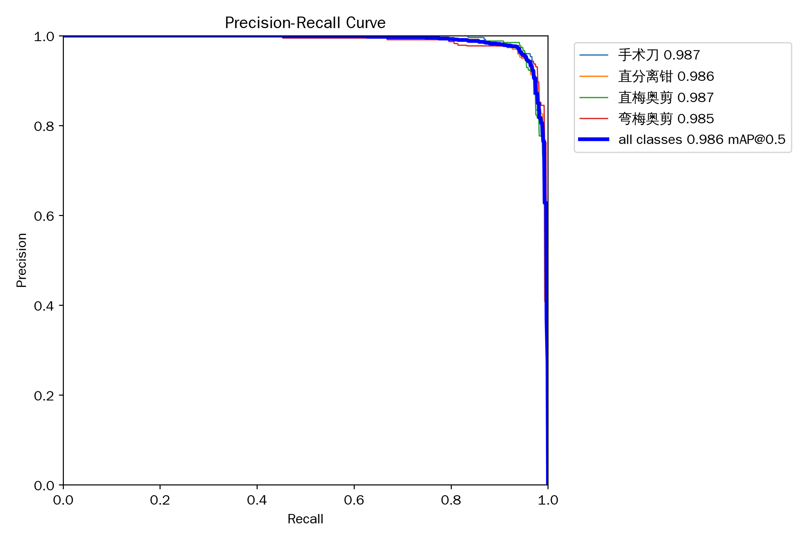
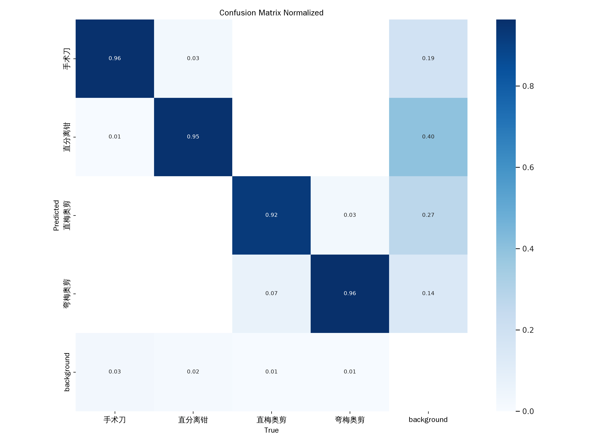

# 手术器械检测 · YOLO11

用 YOLO11n 在手术器械数据集上做**目标检测**：一张图里框出多件器械并给出类别，共 4 类，输出中文标签。
在 AutoDL 的 RTX 5090 上从零训练 100 轮，耗时 11.7 分钟，验证集 **mAP50 98.6% / mAP50-95 92.1%**。



## 效果

| 指标 | 数值 |
|---|---|
| mAP50 | **0.986** |
| mAP50-95 | **0.921** |
| Precision | 0.956 |
| Recall | 0.951 |
| 单张推理 | 0.4–0.7 ms（640 输入，5090） |
| 模型体积 | 5.3 MB（2.58 M 参数 / 6.3 GFLOPs） |

逐类（验证集 786 张、1092 个框）：

| id | 类别 | 实例数 | P | R | mAP50 | mAP50-95 |
|---|---|---|---|---|---|---|
| 0 | 手术刀 Scalpel | 273 | 0.967 | 0.941 | 0.987 | 0.878 |
| 1 | 直分离钳 Straight Dissection Clamp | 273 | 0.959 | 0.941 | 0.986 | 0.870 |
| 2 | 直梅奥剪 Straight Mayo Scissor | 272 | 0.957 | 0.952 | 0.987 | **0.967** |
| 3 | 弯梅奥剪 Curved Mayo Scissor | 274 | 0.941 | 0.971 | 0.985 | **0.967** |

两类剪刀的框贴合精度（0.967）明显好于刀和钳（0.87–0.88）：分类几乎不出错，差在**细长器械的边界回归**。





## 快速开始

```python
from ultralytics import YOLO

model = YOLO("best_cn.pt")                       # 中文类别名已写进权重
results = model.predict("images/", conf=0.25, save=True)
print(results[0].names)                          # {0: '手术刀', 1: '直分离钳', ...}
```

命令行：

```bash
yolo detect predict model=best_cn.pt source=test.jpg conf=0.25 save=True
yolo detect val model=best_cn.pt data=data_cn.yaml
```

## 项目结构

```
.
├── best_cn.pt               # 训练好的权重，类别名为中文（推荐分发）
├── best.pt                  # 同一权重的英文标签版
├── data_cn.yaml             # 中文类别名的数据集配置
├── convert_surgical.py      # 原始数据 → YOLO 格式 + data.yaml
├── train_surgical.py        # 训练入口（参数化命令行）
├── cn_labels.py             # 中文标签：写 data_cn.yaml、预测、重新验证出图
├── detect_cn2.py            # 分层抽样检测 + 预测 vs 标注核对 + 拼图
├── setup_env2.sh            # 一键装 CUDA 12.8 环境（5090 必需）
├── install_font.sh          # 装中文字体并接进 ultralytics / matplotlib
├── imgdemo/                 # 网页演示（推理服务 + 前端 + 隧道）
└── results/                 # 曲线、混淆矩阵、检测示例
```

训练过程中用到的 `probe*.sh` / `check_*.sh` / `diag_*.sh` 等一次性排查脚本已通过 `.gitignore` 排除，未随仓库发布。

## 数据集

原始数据是 Roboflow 风格的 `Surgical-Dataset`（手术器械摆拍，灰度图，640×480）：

```
Surgical-Dataset/
├── Images/All/images/              # 3009 张 jpg
├── Labels/label object names/      # 3009 个 YOLO txt（cls cx cy w h）
├── Labels/label top-bottom/        # 另一套遮挡标注，本任务不用
└── Test-Train Groups/              # 官方 train / test 名单
```

标签本身已是 YOLO 格式，与图片 1:1 对应（3009/3009，无缺失、无重复）。

转换脚本按官方名单划分，并把 389 张不在任何名单里的图补进训练集：

```bash
python convert_surgical.py        # 输出到 /root/autodl-tmp/surgical-yolo
```

| 划分 | 图片 | 标注框 | 各类框数（0/1/2/3） |
|---|---|---|---|
| train | 2223（官方 1834 + 389） | 3115 | 765 / 783 / 699 / 868 |
| val | 786（官方 test 集） | 1092 | 273 / 273 / 272 / 274 |

## 环境

容器基础镜像是 py3.8 + torch 2.0.0+cu118，**跑不了 RTX 5090**（Blackwell 是 `sm_120`，cu118 只支持到 `sm_90`，
实测报 `CUDA error: no kernel image is available`）。所以另建了独立环境。

训练硬件：AutoDL 单卡 RTX 5090 32 GB，宿主 CPU 25 核（与其他实例共享）。

| 组件 | 版本 | 说明 |
|---|---|---|
| Python | 3.11.17 | conda env 在 `/root/autodl-tmp/envs/yolo`（数据盘，不占系统盘） |
| torch | 2.8.0+cu128 | 支持 `sm_120`，必须从 `download.pytorch.org/whl/cu128` 装 |
| ultralytics | 8.3.13 | 与项目自带源码版本一致 |
| numpy | 1.26.4 | **不能用 2.x**：`np.trapz` 被删，ultralytics 8.3.13 还在调 |
| pandas | 2.2.3 | 3.1 要求 numpy≥2，和上一条冲突 |
| opencv | 4.10.0.84 | 5.0 会拉 numpy 2 |
| 字体 | 文泉驿正黑 | 中文标签渲染用 |

一键装（含学术加速代理；torch 轮子 889 MB，连 CUDA 依赖共约 2.5 GB，实测 1 分钟出头）：

```bash
bash setup_env2.sh        # 建环境 + 装 torch/ultralytics + 验证 GPU 算子
bash install_font.sh      # 装中文字体并替换 ultralytics 的 Arial.ttf
```

## 训练

```bash
cd /root/YOLOv11
/root/autodl-tmp/envs/yolo/bin/python train_surgical.py \
  --data /root/autodl-tmp/surgical-yolo/data.yaml \
  --model yolo11n.pt \
  --epochs 100 --imgsz 640 --batch 64 --workers 16 \
  --cache ram --patience 30 \
  --name surgical_yolo11n --project /root/YOLOv11/runs
```

| 参数 | 取值 | 理由 |
|---|---|---|
| batch | 64 | ultralytics 640 下的参考配置（nbs=64）；提到 128 每轮更新时间减半，小数据集上更容易欠拟合 |
| cache | ram | 数据集仅 202 MB，全量进内存省掉重复解码 |
| patience | 30 | 早停；实际 100 轮从头到尾都在涨，没触发 |
| 优化器 | auto | 自动选 AdamW，lr0=0.00125 |

实测 **702 秒 / 100 轮，约 8.5 秒每轮**，显存 9.9 GB。跑到第 70 轮时 mAP50-95 已到 0.886，最后 10 轮在 0.92 附近收敛。

> 关于提速：把 batch 提到 128 能到 6.6 秒/轮（显存 15.7 GB），但每轮只有 18 次参数更新，精度更差，所以正式结果用的是 batch 64。
> 训练时 GPU SM 利用率只在 40~80% 抖动，瓶颈是 CPU 端的 mosaic 增强（4 张图 warpAffine），不是显存。

## 评估

```bash
/root/autodl-tmp/envs/yolo/bin/python -c "
from ultralytics import YOLO
m = YOLO('runs/surgical_yolo11n/weights/best.pt')
r = m.val(data='/root/autodl-tmp/surgical-yolo/data.yaml', plots=True)
print(r.box.map50, r.box.map)"
```

最优轮次是第 99 轮（mAP50-95 = 0.9203），最后一轮 0.9196。

## 中文标签

默认 ultralytics 画的都是英文名，改成中文需要三步（`cn_labels.py` 全做了）：

1. **装字体**：容器里没有任何 CJK 字体，中文会渲染成方框。`install_font.sh` 装 `fonts-wqy-zenhei`，
   并把它复制成 `~/.config/Ultralytics/Arial.ttf`（ultralytics 按这个文件名找字体）。
2. **清 matplotlib 缓存**：字体缓存是安装前生成的，必须删 `~/.cache/matplotlib` 再 `font_manager.addfont()` 注册，
   否则 PR 曲线、混淆矩阵里的中文仍是方框。
3. **类名写进权重**：`model.model.names = {0:'手术刀', ...}` 后 `model.save('best_cn.pt')`，
   这样换台机器、换个人拿到权重也不用改代码。注意 `YOLO.names` 是只读属性，要改 `model.model.names`。

验证：改名前后的指标完全一致（mAP50 0.9861、mAP50-95 0.9206），说明只影响显示。

## 演示站

`imgdemo/` 里是一个独立的网页演示：上传图片 → 阿里云 nginx → SSH 反向隧道 → AutoDL 上的 FastAPI 推理服务。
AutoDL 实例没有公网入站端口，所以用的是实例主动连出的反向隧道。部署细节、运维命令、故障排查见
[imgdemo/README.md](imgdemo/README.md)。

**注意**：实例关机后网页会 502，演示前要先开机并跑一次 `start_all.sh`。

## 已知限制

- **验证集就是官方 test 集**，而且 `best.pt` 是按它选出来的，所以 0.986 偏乐观。严谨评估需要另留一份完全不参与训练和选模的测试集。
- **数据本身很简单**：灰度、干净背景、摆拍、平均每张 1.4 个框。真实手术场景有血迹、反光、器械重叠、光照变化，迁移过去大概率会掉点。
- **多器械同框时置信度下降**：单器械 0.94–0.97，四类同框那张最低到 0.73；器械交叉遮挡时（如 `pinca558`）直分离钳只有 0.50。
- **漏检多于错分类**：混淆矩阵里直分离钳有约 0.40 的比例被判成 background，手术刀 0.19，而类别之间的互混接近 0。
- 只训了 `yolo11n`，没有对比 `yolo11s/m` 或更大输入尺寸（960）的效果。

## 后续可做

- 用 `yolo11s` 或 `imgsz=960` 试精度上限，看细长器械的框回归能改善多少
- 划分独立测试集，做一次诚实的泛化评估
- 导出 ONNX / TensorRT，替代现在的 PyTorch 推理
- 针对 `background` 漏检做分析：按框长宽比、尺度、遮挡程度分桶看误差来源

## 许可证

[MIT](LICENSE)

